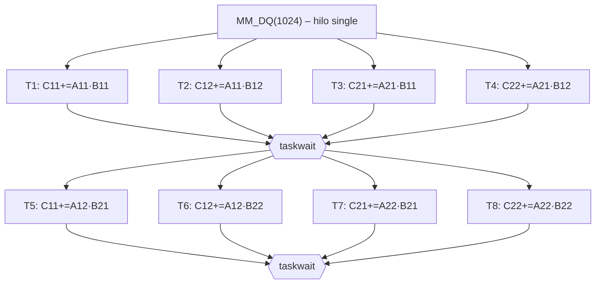

# Práctica 3 – Multiplicación de matrices con OpenMP (SIMD y tareas)

## Ficheros

| Fichero | Contenido |
|---|---|
| `MM.h`, `MM2.h`, `MM_main.cpp` | Originales (sin modificar) |
| `MMpar.h` | Versión paralela de `MM.h`: iterativa con `parallel for`, D&C con `task` + `taskwait` |
| `MMpar2.h` | Versión paralela con las optimizaciones de `MM2.h` (intercambio de bucles + desenrollado 2×2) |
| `Makefile` | Compila todas las variantes (`make`) |
| `test_races.sh` | Paso 2: validación con 8×8, ruido y versiones con condiciones de carrera |
| `bench.sh` | Pasos 3 y 4: barridos de DQSZ y k con `perf stat` |

Macros para los experimentos: `-DNOISE` (mete `sched_yield()` para que los hilos cedan la CPU), `-DNOSYNC` (quita la sincronización a propósito), `-DDEPEND` (D&C sincronizado con `depend` en lugar de `taskwait`).

```bash
make
OMP_NUM_THREADS=4 ./MMpar 2048 64        # D&C paralelo
./MMpar 1024 256 2                        # comprueba 2 veces contra la versión serie
./test_races.sh 100000
./bench.sh 2048 ; DQ=128 ./bench.sh 4096
```

> [!IMPORTANT]
> Hay que usar `TYPE=int`. La suma entera es asociativa (módulo 2³²), así que da exactamente igual en qué orden sumen los hilos y la comprobación bit a bit (`compare`) es válida. Con `float`/`double`, D&C y la versión paralela reordenan las sumas y el resultado cambiaría por redondeo.

---

## Paso 1 – Análisis teórico

### 1.a Versión iterativa, k = 2 hilos

Se reparte el bucle externo `i` con `schedule(static)`:

| Hilo | Lee de `a` | Lee de `b` | Escribe en `c` |
|---|---|---|---|
| 0 | filas 0 … N/2−1 | **toda** la matriz | filas 0 … N/2−1 |
| 1 | filas N/2 … N−1 | **toda** la matriz | filas N/2 … N−1 |

* `a` y `b` solo se leen, así que compartirlas no es un problema.
* Cada `c[i][j]` lo escribe un único hilo (el dueño de la fila `i`): **no hay carreras**.
* La trampa: en `MM.h` los índices `j,k` están declarados fuera del bucle. Si se paraleliza tal cual, quedan **compartidos** y hay una carrera sobre los índices. Por eso se declaran dentro del `for` (son privados). La variante `-DNOSYNC` reproduce precisamente este fallo.
* Paralelizar el bucle `k` (o `k` en el orden i-k-j de MM2) sería incorrecto: varios hilos acumularían sobre el mismo `c[i][j]`. Es la carrera que reproduce `MMpar2 -DNOSYNC`.

### 1.b Versión Divide y Vencerás

Llamamos A11, A12, A21, A22 (y lo mismo para B y C) a los cuadrantes de tamaño SZ/2. Las 8 llamadas recursivas son:

| Tarea | Operación | Lee | Escribe |
|---|---|---|---|
| T1 | C11 += A11·B11 | A11, B11 | C11 |
| T2 | C12 += A11·B12 | A11, B12 | C12 |
| T3 | C21 += A21·B11 | A21, B11 | C21 |
| T4 | C22 += A21·B12 | A21, B12 | C22 |
| T5 | C11 += A12·B21 | A12, B21 | C11 |
| T6 | C12 += A12·B22 | A12, B22 | C12 |
| T7 | C21 += A22·B21 | A22, B21 | C21 |
| T8 | C22 += A22·B22 | A22, B22 | C22 |

* T1–T4 escriben cuadrantes **disjuntos**: son independientes entre sí. Lo mismo pasa con T5–T8.
* T*i* y T*i+4* hacen lectura-modificación-escritura sobre **el mismo** cuadrante de C, y esa es la dependencia que hay que respetar. Hay dos formas de hacerlo:
  * **Opción 1 (la que usa el código):** `taskwait` entre la fase 1 (T1–T4) y la fase 2 (T5–T8).
  * **Opción 2 (`-DDEPEND`):** `depend(inout: Cxy[0])`. Así T5 solo espera a T1, T6 a T2, etc. La concurrencia máxima es la misma, pero no hace falta esperar a la tarea más lenta de la fase.
* Hace falta además un `taskwait` final: una tarea no puede darse por terminada hasta que acabe todo su subárbol. Si no, la fase 2 de su padre empezaría antes de tiempo.
* El algoritmo es correcto: cada `C_ij` recibe exactamente `A_i1·B_1j + A_i2·B_2j`, y la suma entera es conmutativa y asociativa.

#### Grafo de tareas: N = 1024, DQSZ = 512



Cada Ti es un caso base 512×512 (algoritmo clásico).

#### Fórmulas generales

Sea `L = log2(N / DQSZ)` el número de niveles de recursión. En cada nivel, cada tarea crea 8 hijas, pero solo 4 pueden ejecutarse a la vez. El camino crítico tiene `2^L` "rondas" de hojas, porque cada nivel duplica la secuencia.

$$\text{Tareas totales} = \sum_{l=1}^{L} 8^l = \frac{8\,(8^L-1)}{7} \qquad \text{Concurrencia máxima} = 4^L$$

| N | DQSZ | L | Tareas totales | Hojas (casos base) | Concurrencia máx. | Rondas secuenciales (2^L) |
|---|---|---|---|---|---|---|
| 1024 | 512 | 1 | **8** | 8 | **4** | 2 |
| 1024 | 128 | 3 | **584** | 512 | **64** | 8 |
| 1024 | 16 | 6 | **299 592** | 262 144 | **4 096** | 64 |
| 2048 | 1024 | 1 | 8 | 8 | 4 | 2 |
| 2048 | 64 | 5 | 37 448 | 32 768 | 1 024 | 32 |
| 2048 | 16 | 7 | 2 396 744 | 2 097 152 | 16 384 | 128 |

(El número de tareas no coincide con la concurrencia máxima precisamente por el `taskwait`: las tareas internas se quedan bloqueadas esperando a sus hijas.)

---

## Paso 2 – Implementación y validación

* **Iterativa:** `#pragma omp parallel for schedule(static)` sobre `i` (en `MMpar2`, sobre pares de filas).
* **D&C:** `MM_DQ` crea el equipo (`parallel` + `single`) y un único hilo genera el árbol de tareas. Los demás hilos las ejecutan a medida que aparecen.
* **Número de hilos:** se fija con `OMP_NUM_THREADS=k` (si no, OpenMP usa los procesadores lógicos). Para comprobarlo:
  * `perf stat -e task-clock ./MMpar 2048 64`: la línea "CPUs utilized" debe valer ≈ k.
  * `perf stat -e sched:sched_process_fork ./MMpar 2048 64`: cuenta los hilos creados (k−1, porque el maestro ya existe).
* **Detección de carreras** (`./test_races.sh`): con 8×8, 100 000 repeticiones y `sched_yield()`:
  * `MMpar_noise`, `MMpar_dep` y `MMpar2_noise` deben dar `CHECK= SUCCESS` con DQSZ = 0, 4 y 2.
  * `MMpar_race` (sin el `taskwait` intermedio / con `j,k` compartidas) y `MMpar2_race` deben dar `CHECK= FAILS ...`.
  * Con DQSZ = 4 sobre 8×8 solo hay un nivel (8 tareas). Con DQSZ = 2 hay dos niveles (72 tareas), así que es más fácil que las carreras salgan a la luz.

---

## Paso 3 – Análisis de rendimiento (N = 2048)

Hay que ejecutar `./bench.sh 2048` en el equipo del laboratorio y poner aquí los tiempos. Las tendencias esperadas y sus causas son:

**Efecto de DQSZ (k fijo):**

| DQSZ | Comportamiento esperado | Cuello de botella principal |
|---|---|---|
| 4–8 | Muy lento: de 2·10⁶ a 2·10⁷ tareas, cada una con muy poco trabajo | Gestión de tareas (creación, colas, `taskwait`) |
| 16–32 | Mejora; los bucles internos son cortos y vectorizan mal | Overhead residual + bucles cortos |
| **64–128** | **Zona óptima esperada**: tres bloques de 64×64 int ocupan 48 KB (L1/L2) y siguen quedando miles de tareas para repartir | Ancho de banda de L2 / cómputo |
| 256–512 | Empeora: el acceso por columnas a `b` (stride N) se sale de L1/L2 | Fallos de caché |
| 1024 | Solo 8 tareas y 4 concurrentes: con k > 4 sobran hilos | Desequilibrio / falta de paralelismo |
| 2048 | Sin recursión, es la versión serie | — |

**Efecto de k (DQSZ fijo):** la aceleración debería escalar casi linealmente hasta el número de núcleos **físicos**. Con SMT (hyperthreading) la ganancia es pequeña o nula, porque los dos hilos de un núcleo comparten las unidades vectoriales y la caché L1/L2. Por encima del número de CPUs lógicas empeora (cambios de contexto, ver `context-switches` en `perf`). La versión iterativa original escala peor que la D&C con N grande: recorre `b` por columnas entera para cada fila, así que satura el ancho de banda de memoria compartido.

---

## Paso 4 – Optimizaciones (`MMpar2.h`)

1. **Intercambio de bucles (i-j-k → i-k-j).** En el bucle interno, `a[i][k]` pasa a ser un escalar invariante, y `b[k][j]` y `c[i][j]` se recorren con stride 1:
   * Se aprovechan los 16 int de cada línea de caché de 64 B (antes se usaba 1 de cada 16).
   * El prefetcher hardware funciona.
   * El bucle vectoriza con AVX2 (8 int por instrucción). Se ayuda con `__restrict` y `#pragma omp simd`.
   * Con N = 2048/4096 hay un efecto extra: en el orden i-j-k, una columna de `b` tiene stride 8 KB/16 KB (potencia de 2), así que todos sus elementos caen en **el mismo conjunto** de la caché (fallos por conflicto). El intercambio elimina el problema.
2. **Register blocking 2×2 (desenrollado de i y k).** Cada iteración interna carga 2 valores de `b` y lee/escribe 2 de `c`, y con ellos hace 4 multiplicaciones-suma. Los 4 valores de `a` quedan en registros. Así se **reduce a la mitad** el tráfico con memoria por operación, que es el cuello de botella.
3. **N = 4096** (64 MB por matriz, más que la LLC): la iterativa optimizada todavía recorre `b` completa (64 MB) por cada par de filas y queda limitada por el ancho de banda de RAM. La **D&C con el núcleo optimizado** mantiene los bloques en caché, así que debería ser la más rápida. Lo esperable es que el DQSZ óptimo con el núcleo vectorizado sea algo mayor (128–256), porque el bucle `j` largo aprovecha mejor SIMD.

> [!NOTE]
> Los tiempos concretos dependen de la máquina. Hay que rellenar las tablas con la salida de `bench.sh` y comparar `MM` frente a `MMpar` (aceleración por paralelismo) y `MMpar` frente a `MMpar2` (aceleración por localidad/registros), para N = 2048 y 4096.
